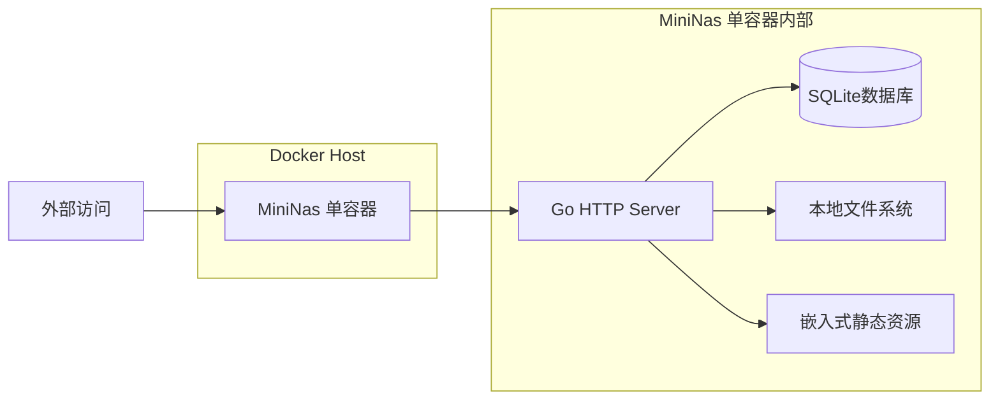

# MiniNas 部署方案文档

## 1. 部署概述

MiniNas 采用 Docker 单容器部署，提供一键部署方案，简化安装和配置流程。用户只需一条命令即可完成服务端部署，无需额外配置数据库、缓存或对象存储服务。

**部署目标：**
- 部署时间 < 5分钟
- 零配置启动（默认配置可用）
- 单容器部署，简化维护
- 跨平台兼容（Linux/Windows/macOS）
- 资源占用：内存 < 256MB，CPU < 5%（空闲状态）

---

## 2. 部署架构

### 2.1 单容器架构



### 2.2 服务组件

| 组件 | 说明 |
|------|------|
| Go HTTP Server | 内置路由、中间件、HTTPS支持 |
| SQLite数据库 | 嵌入式数据库，零配置 |
| 本地文件系统 | 直接存储用户文件 |
| 嵌入式静态资源 | WEB管理系统前端资源 |

---

## 3. 环境要求

### 3.1 硬件要求

| 配置 | 最低要求 | 推荐配置 |
|------|----------|----------|
| CPU | 1核 | 2核+ |
| 内存 | 1GB | 2GB+ |
| 存储 | 50GB | 200GB+ |
| 网络 | 100Mbps | 1Gbps |

### 3.2 软件要求

| 软件 | 版本 |
|------|------|
| Docker | 20.10+ |
| Linux | Ubuntu 20.04+/Debian 10+/CentOS 8+ |
| Windows | Windows 10 1903+/Windows Server 2019+ |
| macOS | macOS 10.15+ |

---

## 4. 一键部署

### 4.1 快速部署命令

```bash
# 创建部署目录
mkdir -p ~/mininas && cd ~/mininas

# 创建数据目录
mkdir -p data/files

# 启动服务（单命令）
docker run -d \
  --name mininas \
  -p 80:8080 \
  -v $(pwd)/data:/data \
  -e MININAS_ADMIN_EMAIL=admin@example.com \
  -e MININAS_ADMIN_PASSWORD=your_password \
  mininas/mininas:latest
```

### 4.2 配置环境变量

创建 `.env` 文件自定义配置：

```bash
# 服务端配置
MININAS_PORT=8080
MININAS_HOST=0.0.0.0

# 管理员账户（首次部署时创建）
MININAS_ADMIN_EMAIL=admin@example.com
MININAS_ADMIN_PASSWORD=your_password

# 存储配置
MININAS_DATA_DIR=/data
MININAS_FILES_DIR=/data/files

# 安全配置
MININAS_ENABLE_HTTPS=false
MININAS_SSL_CERT_PATH=
MININAS_SSL_KEY_PATH=

# 网络配置
MININAS_ALLOWED_HOSTS=*
MININAS_MAX_UPLOAD_SIZE=1073741824

# 日志配置
MININAS_LOG_LEVEL=info
```

### 4.3 Docker 运行命令

```bash
# 使用 .env 文件启动
docker run -d \
  --name mininas \
  -p 80:8080 \
  -v $(pwd)/data:/data \
  --env-file .env \
  mininas/mininas:latest
```

### 4.4 Docker Compose 文件（可选）

```yaml
version: '3.8'

services:
  mininas:
    image: mininas/mininas:latest
    container_name: mininas
    ports:
      - "80:8080"
      - "443:8443"
    volumes:
      - ./data:/data
    environment:
      - MININAS_PORT=8080
      - MININAS_HOST=0.0.0.0
      - MININAS_ADMIN_EMAIL=admin@example.com
      - MININAS_ADMIN_PASSWORD=your_password
      - MININAS_DATA_DIR=/data
      - MININAS_FILES_DIR=/data/files
    restart: unless-stopped
```

---

## 5. 配置说明

### 5.1 端口配置

| 端口 | 用途 | 默认值 |
|------|------|--------|
| 8080 | HTTP服务 | 8080 |
| 8443 | HTTPS服务（启用时） | 8443 |

### 5.2 HTTPS配置

**方式一：使用内置证书生成**

```bash
# 启动时自动生成自签名证书
docker run -d \
  --name mininas \
  -p 8443:8443 \
  -v $(pwd)/data:/data \
  -e MININAS_ENABLE_HTTPS=true \
  mininas/mininas:latest
```

**方式二：使用自定义证书**

```bash
# 将证书文件放在 data/cert 目录
mkdir -p data/cert
cp your_cert.crt data/cert/
cp your_key.key data/cert/

# 启动服务
docker run -d \
  --name mininas \
  -p 8443:8443 \
  -v $(pwd)/data:/data \
  -e MININAS_ENABLE_HTTPS=true \
  -e MININAS_SSL_CERT_PATH=/data/cert/your_cert.crt \
  -e MININAS_SSL_KEY_PATH=/data/cert/your_key.key \
  mininas/mininas:latest
```

**方式三：使用 Let's Encrypt 证书**

```bash
# 安装 certbot
apt-get install certbot

# 获取证书
certbot certonly --standalone -d your-domain.com

# 复制证书到数据目录
mkdir -p data/cert
cp /etc/letsencrypt/live/your-domain.com/fullchain.pem data/cert/
cp /etc/letsencrypt/live/your-domain.com/privkey.pem data/cert/

# 启动服务
docker run -d \
  --name mininas \
  -p 8443:8443 \
  -v $(pwd)/data:/data \
  -e MININAS_ENABLE_HTTPS=true \
  -e MININAS_SSL_CERT_PATH=/data/cert/fullchain.pem \
  -e MININAS_SSL_KEY_PATH=/data/cert/privkey.pem \
  mininas/mininas:latest
```

---

## 6. 首次启动

### 6.1 初始化流程

1. **启动服务**：运行 `docker run` 命令
2. **等待服务就绪**：等待约10秒，服务启动完成
3. **访问 WEB 管理系统**：打开浏览器访问 `http://your-server-ip`
4. **登录系统**：使用管理员账户登录（默认 admin@example.com / your_password）
5. **配置系统参数**：设置存储路径、网络配置等
6. **完成初始化**：进入系统仪表盘

### 6.2 验证部署

```bash
# 检查容器状态
docker ps

# 查看日志
docker logs -f mininas

# 测试 API
curl http://localhost:8080/api/v1/health
```

### 6.3 语义检索（可选）

语义检索（中文文搜图、以图搜图）依赖模型与推理运行时，未就绪时其余功能不受影响，
相关接口统一返回 503。

**前置条件**

1. 模型产物放到 `./server/models/cn-clip-vit-b16/`（compose 会只读挂到 `/data/models`）。
   仓库不含 ONNX 权重，用 `scripts/setup_model.sh` 一键导出，或从已有部署复制。
2. 宿主安装 iGPU 驱动并放行 `render` 组（容器内已装用户态驱动）：
   ```bash
   sudo apt-get install -y intel-opencl-icd libze-intel-gpu1
   sudo usermod -aG render $USER        # 重新登录后生效
   ls /dev/dri/                          # 应能看到 card1 与 renderD128
   ```

**启动后自检**

```bash
# 需要先登录拿 token
curl -H "Authorization: Bearer $TOKEN" http://localhost:8080/api/index/health
```

返回里重点看三项：`device`（GPU/CPU）、`warmup_ms`（GPU 首次编译 3.7~5.2s）、
`selftest.pass`（与 PyTorch 参考输出的余弦，必须为 true）。
**`selftest` 失败说明推理结果不可信**，此时服务会自动关闭语义检索而不是带着错向量上线。

**建索引**

Web 端「智能检索」面板里点「增量索引」即可；也可以直接调接口：

```bash
curl -X POST -H "Authorization: Bearer $TOKEN" -H 'Content-Type: application/json' \
  -d '{"full":false}' http://localhost:8080/api/index/scan
```

- 增量：只处理新增/修改过的图片（`size:mtime` 变化或还没有向量）
- 全量：`{"full":true}`，换模型或怀疑索引损坏时使用
- GPU 下 14k 张约 29 分钟，CPU 约 3 小时；建议低峰期执行，或用 `ai.throttle_ms` 限速

**关闭**

配置 `ai.enabled=false` 后重启即可，语义索引表与向量保留，随时可再打开。

**单容器部署（不用 compose）**

`server/Dockerfile`（前端嵌入二进制）同样是 cgo 构建，运行时要补两处：

```bash
docker run -d --name mininas -p 80:8080 \
  -v $(pwd)/data:/data \
  -v $(pwd)/server/models:/data/models:ro \
  --device /dev/dri:/dev/dri --group-add render \
  mininas/mininas:latest
```

漏掉 `--device` 不会报错，只会静默降级到 CPU（`/api/index/health` 里的 `device`
会显示 `CPU`，索引慢约 6 倍）。漏掉模型挂载则语义检索整体返回 503，其余功能正常。

---

## 7. 数据迁移

### 7.1 备份数据

```bash
# 停止服务
docker stop mininas

# 备份整个数据目录
tar -czvf mininas_backup.tar.gz ./data

# 启动服务
docker start mininas
```

### 7.2 恢复数据

```bash
# 停止服务
docker stop mininas

# 删除旧数据
rm -rf ./data

# 恢复备份
tar -xzvf mininas_backup.tar.gz

# 启动服务
docker start mininas
```

---

## 8. 升级方案

### 8.1 升级步骤

```bash
# 停止服务
docker stop mininas

# 备份数据
tar -czvf backup_before_upgrade.tar.gz ./data

# 删除旧容器
docker rm mininas

# 拉取最新镜像
docker pull mininas/mininas:latest

# 启动新容器
docker run -d \
  --name mininas \
  -p 80:8080 \
  -v $(pwd)/data:/data \
  --env-file .env \
  mininas/mininas:latest
```

### 8.2 版本兼容

| 版本 | 升级说明 |
|------|----------|
| v1.x -> v1.y | 直接升级，数据兼容 |
| v1.x -> v2.x | 需要执行数据库迁移脚本 |

---

## 9. 远程访问配置

### 9.1 端口转发配置

**路由器端口转发设置：**
1. 登录路由器管理后台
2. 找到"端口转发"或"虚拟服务器"设置
3. 添加转发规则：
   - 外部端口：80（或自定义端口）
   - 内部端口：8080
   - 内部IP：MiniNas 服务器的内网IP
4. 保存配置

**测试远程访问：**
```bash
# 使用公网IP测试
curl http://your-public-ip:port/api/v1/health
```

### 9.2 DDNS配置（动态公网IP）

**使用 Cloudflare DDNS：**
1. 在 Cloudflare 注册账户并添加域名
2. 获取 API Token
3. 使用 DDNS 脚本更新 IP

```bash
# 安装 ddns 脚本
curl -sSL https://raw.githubusercontent.com/timothymiller/cloudflare-dns/master/cloudflare.sh | bash -s -- \
  --api-token YOUR_API_TOKEN \
  --zone example.com \
  --record mininas.example.com \
  --type A
```

### 9.3 WireGuard VPN配置（推荐）

**服务端配置：**

```bash
# 创建 WireGuard 配置目录
mkdir -p data/wireguard

# 启动 WireGuard 容器
docker run -d \
  --name wireguard \
  --cap-add=NET_ADMIN \
  --cap-add=SYS_MODULE \
  -e PUID=1000 \
  -e PGID=1000 \
  -e TZ=Asia/Shanghai \
  -e SERVERURL=your-domain.com \
  -e SERVERPORT=51820 \
  -e PEERS=phone,laptop \
  -e PEERDNS=1.1.1.1 \
  -v $(pwd)/data/wireguard:/config \
  -v /lib/modules:/lib/modules \
  -p 51820:51820/udp \
  --sysctl="net.ipv4.conf.all.src_valid_mark=1" \
  linuxserver/wireguard
```

**客户端配置：**
1. 在 WireGuard APP 中导入配置文件
2. 连接 VPN
3. 使用内网IP访问 MiniNas

---

## 10. 常见问题

### 10.1 端口冲突

```bash
# 检查端口占用
netstat -tlnp | grep 8080

# 修改端口映射
docker run -d \
  --name mininas \
  -p 8081:8080 \
  -v $(pwd)/data:/data \
  mininas/mininas:latest
```

### 10.2 存储不足

```bash
# 查看存储使用
df -h

# 扩展存储
# 将数据目录挂载到更大的磁盘
mount /dev/sdb1 ~/mininas/data
```

### 10.3 服务启动失败

```bash
# 查看日志
docker logs mininas

# 检查配置
docker exec mininas cat /etc/mininas/config.yaml

# 检查数据目录权限
ls -la ./data
```

### 10.4 远程访问失败

```bash
# 检查端口转发是否生效
curl http://localhost:8080/api/v1/health

# 检查防火墙设置
ufw status

# 检查路由器配置
# 确保端口转发规则正确
```

---

## 11. 安全加固

### 11.1 基础安全

- **修改默认密码**：首次登录后立即修改管理员密码
- **关闭不必要端口**：只开放必要端口（80/443）
- **启用防火墙**：配置防火墙规则

### 11.2 进阶安全

- **启用 HTTPS**：配置 SSL 证书
- **配置域名**：使用域名访问，避免 IP 直接暴露
- **限制访问IP**：在 WEB 管理系统中配置 IP 白名单
- **定期更新**：定期更新 Docker 镜像和系统

---

## 12. 监控与维护

### 12.1 监控命令

```bash
# 查看容器状态
docker ps

# 查看资源使用
docker stats

# 查看日志
docker logs -f mininas

# 检查服务健康
curl http://localhost:8080/api/v1/health

# 查看存储使用
du -sh ./data
```

### 12.2 定期维护

- **每日**：检查服务状态和日志
- **每周**：备份数据
- **每月**：更新 Docker 镜像
- **每季度**：清理日志和临时文件

---

## 13. 卸载方案

### 13.1 停止并移除容器

```bash
# 停止服务
docker stop mininas

# 移除容器
docker rm mininas

# 移除镜像
docker rmi mininas/mininas:latest
```

### 13.2 删除数据

```bash
# 删除数据目录（谨慎操作）
rm -rf ~/mininas
```