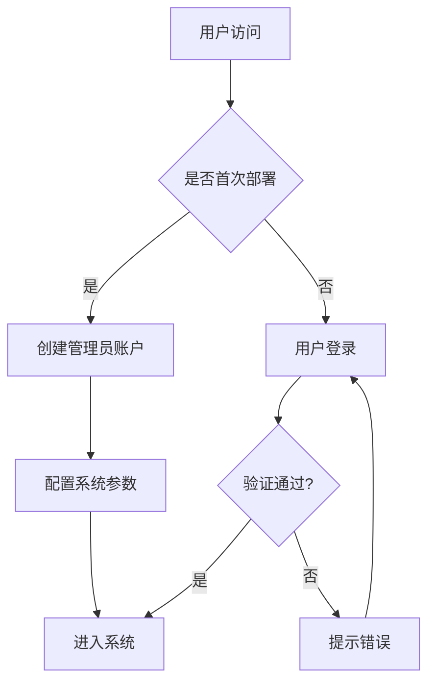
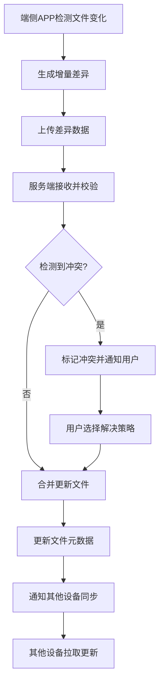
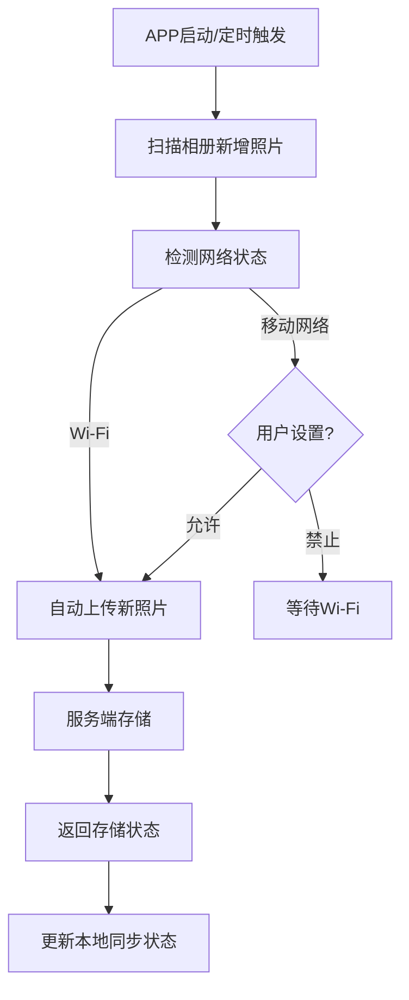
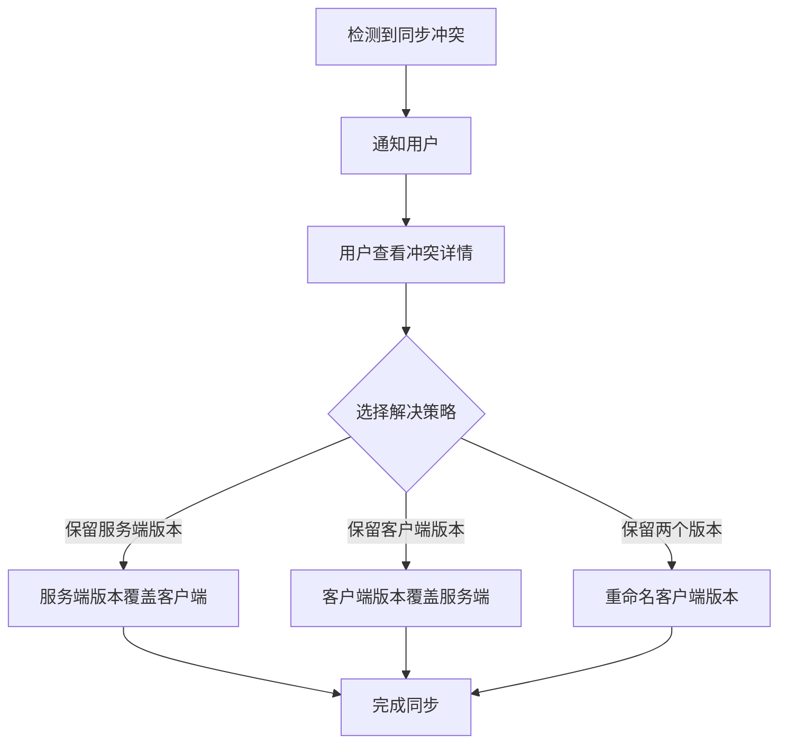
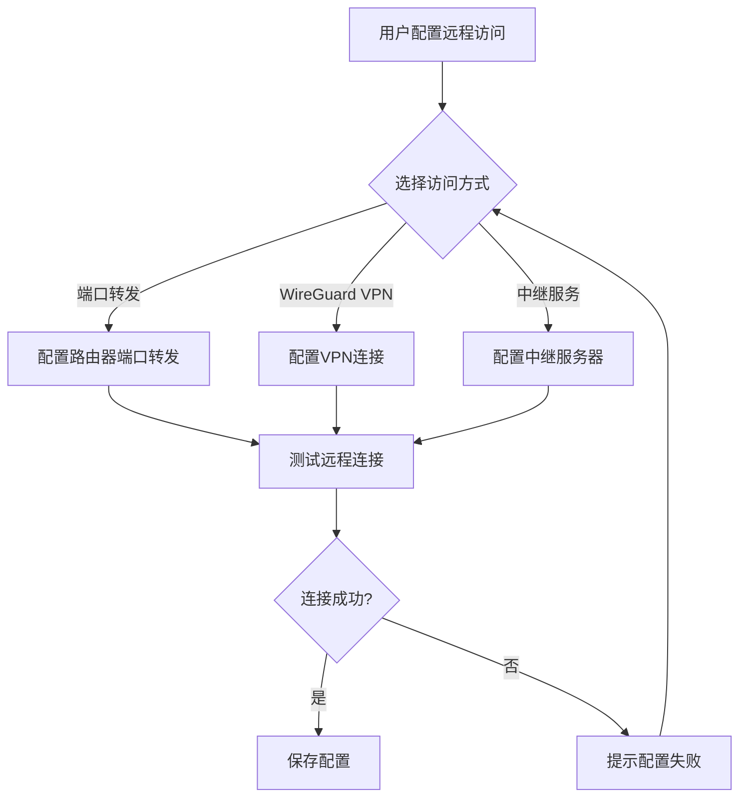

# MiniNas 产品需求文档

## 1. 产品概述

MiniNas 是一款面向普通家用用户的数据同步应用，旨在解决端侧设备数据存储和同步问题。用户可在家用硬件设备（NAS、迷你主机、工作站、台式机、笔记本）上部署 MiniNas 服务，实现手机等端侧设备数据的自动同步、持久化存储与安全管理，释放端侧设备空间，避免换设备后数据丢失。

**目标用户：**
- 普通家庭用户，关心数据隐私安全
- 拥有家用NAS/迷你主机的用户
- 需要跨设备同步数据的个人用户

**市场价值：**
- 解决数据隐私安全问题，数据存储在用户自己的设备上
- 轻量化部署，相比 nextcloud 更易于安装和维护
- 提供端侧APP+WEB管理系统的完整体验
- **核心特色**：文件卸载功能，释放端侧设备空间的同时保持数据可访问

---

## 2. 核心功能

### 2.1 用户角色

| 角色 | 注册方式 | 核心权限 |
|------|----------|----------|
| 管理员 | 首次部署时创建 | 管理系统配置、用户管理、存储空间管理、网络配置 |
| 普通用户 | 管理员邀请/注册 | 上传下载文件、数据同步、查看共享文件、释放空间 |

### 2.2 功能模块

#### 2.2.1 服务端模块

1. **文件同步服务**：核心文件同步引擎，支持增量同步、断点续传、冲突检测与解决
2. **用户管理**：用户注册、登录、权限管理、邀请码机制
3. **存储空间管理**：容量监控、配额管理、存储策略配置
4. **设备管理**：绑定设备管理、设备状态监控、远程唤醒
5. **数据安全**：文件加密、访问日志、备份恢复
6. **系统配置**：网络设置、存储路径配置、同步策略设置、NAT穿透配置
7. **文件卸载服务**：缩略图管理、文件状态标记、恢复下载

#### 2.2.2 WEB管理系统模块

1. **仪表盘**：系统概览、存储使用情况、设备状态、同步统计
2. **文件管理**：文件浏览、上传下载、文件夹管理、释放空间
3. **用户管理**：用户列表、权限设置、邀请用户
4. **设备管理**：绑定设备列表、设备状态、设备同步设置、冲突管理
5. **系统设置**：存储配置、网络配置、NAT穿透设置、安全设置、日志查看
6. **共享管理**：共享链接创建、访问权限、有效期设置

#### 2.2.3 端侧APP模块（安卓）

1. **数据同步**：相册自动同步、文件手动上传、增量同步、冲突解决
2. **文件浏览**：云端文件查看、下载到本地、在线预览、缩略图浏览
3. **相册管理**：按时间/相册分组查看、照片详情、删除操作、释放空间
4. **备份管理**：备份任务管理、备份进度查看、恢复功能
5. **设备管理**：添加/切换服务端、离线模式、网络设置、NAT穿透配置
6. **空间管理**：释放空间、智能卸载、存储空间分析

### 2.3 页面详情

#### 2.3.1 WEB管理系统

| 页面名称 | 模块名称 | 功能描述 |
|----------|----------|----------|
| 登录页 | 登录模块 | 用户登录、密码重置、版本信息展示 |
| 仪表盘 | 概览模块 | 存储使用图表、在线设备数、最近同步记录、冲突提醒 |
| 文件管理 | 文件模块 | 文件列表展示、上传下载、新建文件夹、删除移动、释放空间 |
| 用户管理 | 用户模块 | 用户列表、添加用户、权限设置、禁用用户 |
| 设备管理 | 设备模块 | 绑定设备列表、设备状态、同步状态、解绑设备、冲突管理 |
| 系统设置 | 设置模块 | 存储路径配置、网络端口配置、NAT穿透设置、安全设置、日志 |
| 共享管理 | 共享模块 | 共享链接创建、访问权限、有效期设置 |

#### 2.3.2 端侧APP

| 页面名称 | 模块名称 | 功能描述 |
|----------|----------|----------|
| 登录页 | 登录模块 | 服务端地址配置、用户登录、自动登录、NAT穿透模式选择 |
| 首页 | 概览模块 | 存储空间使用、最近同步记录、快捷操作入口、释放空间推荐 |
| 相册同步 | 相册模块 | 照片列表、同步状态、手动同步、相册选择、释放空间 |
| 文件浏览 | 文件模块 | 文件列表、文件夹导航、下载上传、删除、缩略图预览 |
| 备份管理 | 备份模块 | 备份任务列表、备份进度、恢复备份、定时备份设置 |
| 空间管理 | 空间模块 | 存储空间分析、智能卸载建议、释放空间操作、卸载历史 |
| 设置页 | 设置模块 | 服务端配置、同步策略、网络设置、NAT穿透配置、关于 |

---

## 3. 核心流程

### 3.1 用户注册与登录流程



### 3.2 文件同步流程



### 3.3 相册自动同步流程



### 3.4 文件卸载流程（核心特色）

```mermaid
flowchart TD
    A[用户进入空间管理] --> B[查看存储空间分析]
    B --> C[选择"释放空间"]
    C --> D[选择要卸载的文件/相册]
    D --> E[生成缩略图]
    E --> F[上传缩略图到服务端]
    F --> G[删除本地原文件]
    G --> H[标记文件为已卸载]
    H --> I[显示释放空间大小]
```

### 3.5 冲突解决流程



### 3.6 NAT穿透与远程访问流程



---

## 4. 用户界面设计

### 4.1 设计风格

- **主色调**：深蓝色系 (#1e3a5f) - 体现科技感和安全感
- **辅助色**：青绿色 (#00d4aa) - 用于强调和交互元素
- **中性色**：深灰 (#2d3748)、浅灰 (#f7fafc) - 用于背景和文字
- **按钮风格**：圆角矩形 (border-radius: 8px)，扁平化设计
- **字体**：无衬线字体，清晰易读
- **布局风格**：卡片式布局，简洁明了
- **图标风格**：线性图标，统一风格

### 4.2 页面设计概述

#### WEB管理系统

| 页面名称 | 模块名称 | UI元素 |
|----------|----------|--------|
| 登录页 | 登录模块 | 居中登录卡片、Logo、输入框、登录按钮 |
| 仪表盘 | 概览模块 | 统计卡片网格、存储使用环形图、最近活动列表、冲突提醒Badge |
| 文件管理 | 文件模块 | 文件图标网格/列表视图、操作工具栏、面包屑导航、释放空间按钮 |
| 用户管理 | 用户模块 | 用户列表表格、搜索框、操作按钮组 |
| 设备管理 | 设备模块 | 设备卡片列表、状态指示器、同步进度条、冲突管理入口 |
| 系统设置 | 设置模块 | 表单分组、开关控件、配置项列表、NAT穿透配置区域 |

#### 端侧APP

| 页面名称 | 模块名称 | UI元素 |
|----------|----------|--------|
| 登录页 | 登录模块 | 服务端地址输入、用户名密码输入、登录按钮、连接模式选择 |
| 首页 | 概览模块 | 存储使用卡片、快捷操作入口、最近同步记录列表、释放空间推荐卡片 |
| 相册同步 | 相册模块 | 照片网格、同步状态Badge、选择模式、释放空间操作 |
| 文件浏览 | 文件模块 | 文件列表、浮动操作按钮、下拉刷新、缩略图预览 |
| 空间管理 | 空间模块 | 存储空间分析图表、智能卸载建议、释放空间按钮、卸载历史列表 |
| 设置页 | 设置模块 | 设置项列表、开关控件、NAT穿透配置、关于信息 |

### 4.3 响应式设计

- **WEB管理系统**：桌面优先，支持平板响应式布局
- **端侧APP**：移动端优先，适配不同屏幕尺寸
- **触摸优化**：大按钮、合理间距、手势支持

---

## 5. 核心功能详细设计

### 5.1 文件卸载功能（核心特色）

**功能描述：** 用户可以将已同步到服务端的文件从设备上删除，只保留缩略图或占位符，从而释放设备存储空间。需要时可以随时从服务端下载恢复原文件。

**使用场景：**
- 用户手机存储空间不足
- 照片已安全备份到服务端
- 需要访问照片但不需要原始高清版本

**功能流程：**
1. 用户进入空间管理页面，查看存储空间分析
2. 系统推荐可卸载的文件（如已同步的旧照片）
3. 用户选择要卸载的文件或相册
4. APP为图片/视频生成低分辨率缩略图
5. 缩略图上传到服务端存储
6. 删除设备上的原文件
7. 更新文件元数据，标记为"已卸载"
8. 显示释放的空间大小

**恢复流程：**
1. 用户浏览已卸载文件的缩略图
2. 用户点击下载按钮
3. APP从服务端下载原文件
4. 更新文件状态为"已下载"

### 5.2 冲突解决策略

**冲突场景：** 同一文件在多个设备上被修改，导致同步时出现版本不一致。

**解决策略：**

| 策略 | 说明 | 适用场景 |
|------|------|----------|
| 保留服务端版本 | 服务端版本优先，覆盖客户端 | 自动解决，无需用户干预 |
| 保留客户端版本 | 客户端版本优先，覆盖服务端 | 用户确认覆盖服务端 |
| 保留两个版本 | 重命名客户端版本，保留两份 | 用户手动处理 |

**冲突处理流程：**
1. 服务端检测到文件冲突
2. 标记文件为冲突状态
3. 通知所有相关设备
4. 用户在APP或WEB管理系统中查看冲突详情
5. 用户选择解决策略
6. 执行解决操作
7. 更新文件状态

### 5.3 NAT穿透与远程访问

**问题描述：** 家用网络通常处于NAT后面，端侧设备（如手机）在外出时无法直接访问家中的MiniNas服务。

**解决方案：**

| 方案 | 说明 | 优点 | 缺点 |
|------|------|------|------|
| 端口转发 | 配置路由器端口转发规则 | 简单直接，性能好 | 需要公网IP，安全风险较高 |
| WireGuard VPN | 建立加密VPN隧道 | 安全，无需端口转发 | 配置稍复杂 |
| 中继服务 | 通过第三方服务器转发 | 无需公网IP，配置简单 | 依赖第三方服务，有延迟 |

**推荐方案：** MVP阶段优先支持端口转发，后续版本添加WireGuard VPN支持。

### 5.4 Android后台同步策略

**问题描述：** Android系统的Doze模式和电池优化会限制后台任务执行，影响文件同步。

**解决方案：**

| 场景 | 策略 |
|------|------|
| 电量充足 | 正常同步 |
| 电量不足 | 暂停同步，等待充电 |
| Wi-Fi连接 | 自动同步 |
| 移动网络 | 用户确认后同步 |
| 应用在前台 | 实时同步 |
| 应用在后台 | 定时同步（每小时） |
| Doze模式 | 使用WorkManager延迟到维护窗口 |

**技术实现：**
- 使用WorkManager进行后台任务调度
- 设置网络和充电约束条件
- 实现指数退避策略
- 监听设备唤醒事件

---

## 6. 非功能需求

### 6.1 性能需求

- 单文件上传速度：支持最大 100MB/s（取决于网络）
- 增量同步延迟：< 30秒检测到变化
- 并发连接数：支持至少 10 个设备同时在线
- 服务端启动时间：< 10秒
- 缩略图生成时间：< 1秒/张（1080p照片）
- 冲突检测时间：< 5秒

### 6.2 安全需求

- 数据传输：HTTPS/TLS 加密
- 文件存储：AES-256 加密
- 用户认证：JWT Token 认证
- 访问控制：基于角色的权限管理
- 日志审计：完整的操作日志记录
- VPN连接：WireGuard加密隧道

### 6.3 可靠性需求

- 服务可用性：99.9%
- 数据完整性：文件校验和验证
- 断点续传：支持大文件断点续传
- 数据恢复：支持备份恢复功能
- 冲突处理：自动检测和人工解决

### 6.4 兼容性需求

- 服务端操作系统：Linux (Ubuntu/Debian/CentOS)、Windows、macOS
- 端侧设备：Android 8.0+
- 浏览器支持：Chrome、Firefox、Safari、Edge（最新版）
- 网络环境：支持NAT网络、IPv4/IPv6

---

## 7. 产品路线图

### MVP 阶段（核心功能）
- 服务端基础服务（用户认证、文件存储、SQLite数据库）
- WEB管理系统（文件管理、用户管理、仪表盘）
- 安卓APP（相册同步、文件浏览、释放空间）
- Docker单容器一键部署
- 端口转发远程访问
- 基础冲突解决策略

### 第二阶段（功能增强）
- WireGuard VPN远程访问
- 设备远程唤醒
- 共享链接功能
- 备份恢复功能
- 智能卸载建议

### 第三阶段（高级功能）
- 多用户协作
- 文件版本管理
- 媒体文件智能分类
- 移动端离线模式优化
- 中继服务支持

---

## 8. 成功标准

- 部署时间：< 5分钟完成 Docker 部署
- 同步成功率：> 99%
- 用户满意度：> 4.5/5
- 资源占用：内存 < 256MB，CPU < 5%（空闲状态）
- 文件卸载成功率：> 99%
- 冲突解决率：> 95%