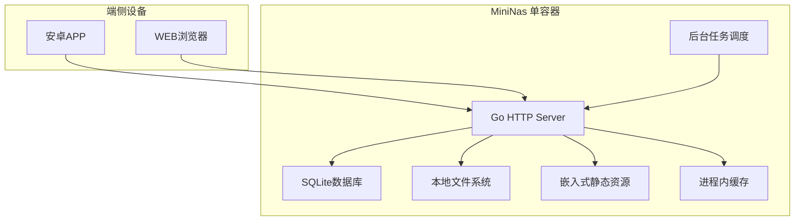
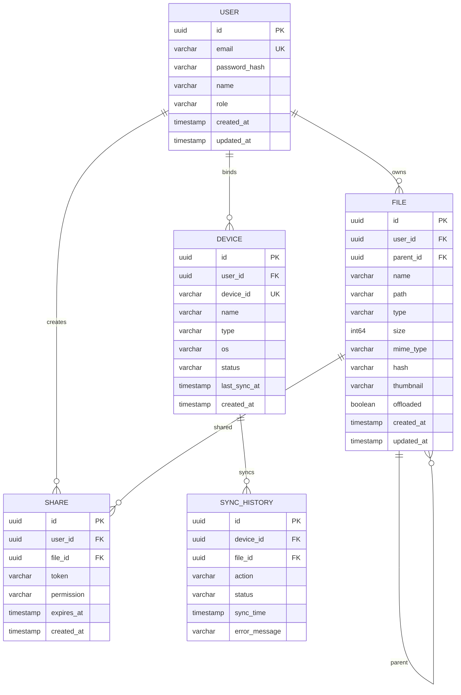
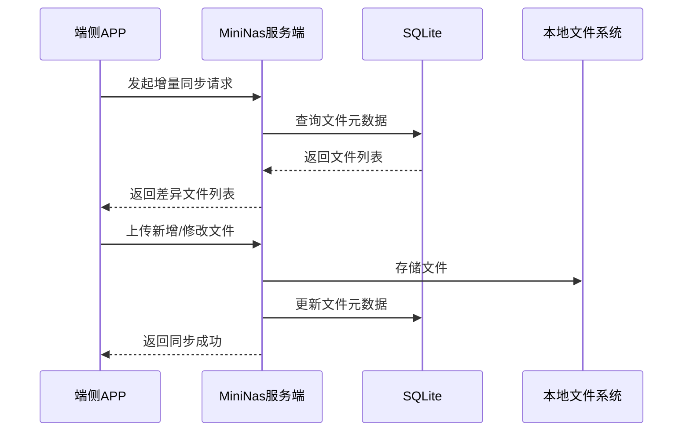
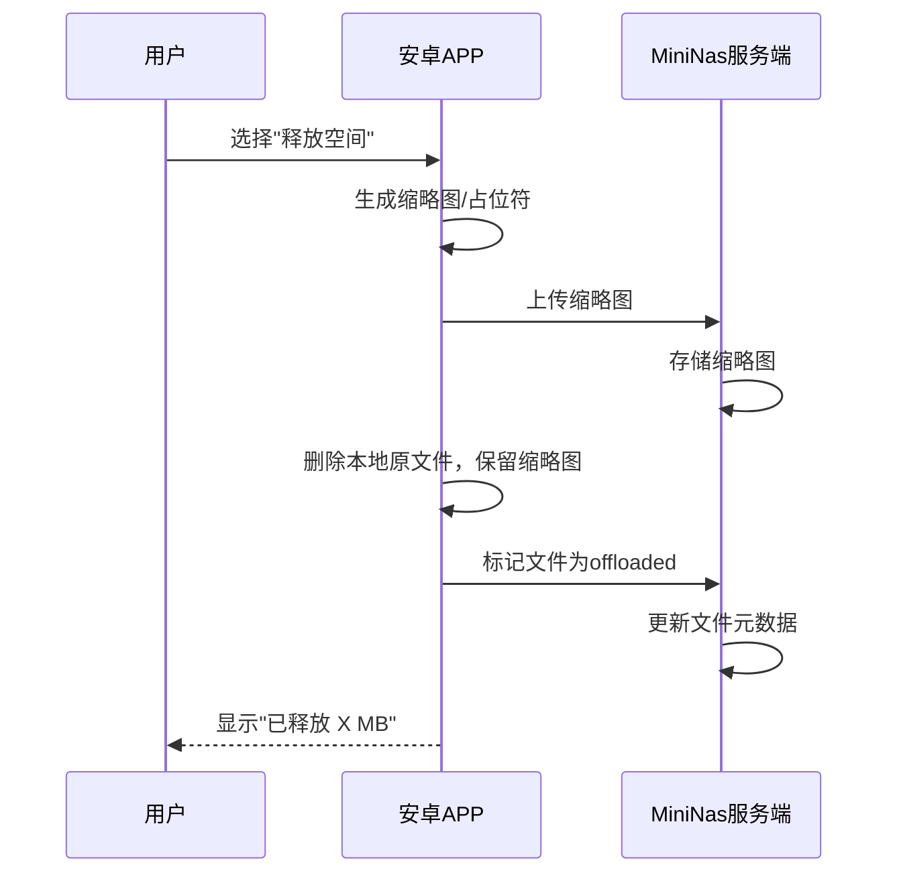

# MiniNas 技术架构设计文档

## 1. 架构设计

### 1.1 整体架构图（轻量级单容器模型）



### 1.2 架构分层说明

| 层级 | 组件 | 职责 |
|------|------|------|
| 接入层 | Go HTTP Server | 直接处理HTTP请求，内置路由和中间件 |
| 业务层 | 各业务模块 | 用户认证、文件同步、设备管理、存储管理 |
| 数据层 | SQLite + 本地文件系统 | 结构化数据和文件数据持久化 |
| 缓存层 | 进程内缓存 | 用户会话、文件元数据缓存 |

### 1.3 架构优势

| 特性 | 说明 |
|------|------|
| 单容器部署 | 仅需一个Docker容器，简化部署和维护 |
| 零依赖 | 无需独立数据库、缓存、对象存储服务 |
| 嵌入式WEB | 静态资源嵌入二进制，无需Nginx |
| 低资源占用 | 内存<256MB，CPU<5%（空闲状态） |
| 易于备份 | 数据存储在单一目录，一键备份 |

---

## 2. 技术选型

### 2.1 服务端技术栈

| 分类 | 技术 | 版本 | 选型理由 |
|------|------|------|----------|
| 语言 | Go | 1.22+ | 高性能、编译型语言，单二进制部署，低资源占用 |
| 框架 | Gin | 最新 | 轻量级Web框架，高性能路由 |
| ORM | GORM | 最新 | Go语言流行ORM，支持SQLite |
| 数据库 | SQLite | 3+ | 嵌入式数据库，零配置，适合单机部署 |
| 文件存储 | 本地文件系统 | - | 直接存储文件，简单直观，易于备份 |
| 缓存 | 进程内缓存 | - | Go sync.Map，轻量级，适合低并发场景 |
| 认证 | JWT | - | 无状态认证，适合单机部署 |
| 任务调度 | Go内置定时器 | - | 轻量级定时任务，无需独立调度服务 |

### 2.2 前端技术栈（WEB管理系统）

| 分类 | 技术 | 版本 | 选型理由 |
|------|------|------|----------|
| 框架 | React | 18+ | 组件化开发，生态成熟 |
| 构建工具 | Vite | 6+ | 快速开发构建工具 |
| 样式 | TailwindCSS | 3+ | 原子化CSS，快速构建UI |
| 状态管理 | Zustand | 最新 | 轻量级状态管理 |
| UI组件库 | shadcn/ui | 最新 | 高质量React组件库 |
| 图表 | Chart.js | 最新 | 简单易用的图表库 |
| HTTP客户端 | Axios | 最新 | Promise-based HTTP客户端 |

### 2.3 移动端技术栈（安卓APP）

| 分类 | 技术 | 版本 | 选型理由 |
|------|------|------|----------|
| 框架 | Kotlin | 1.9+ | Android官方推荐语言，简洁安全 |
| UI框架 | Jetpack Compose | 1.6+ | 现代声明式UI框架 |
| 网络请求 | Retrofit | 最新 | 类型安全的HTTP客户端 |
| 图片加载 | Coil | 最新 | 高性能图片加载库 |
| 数据库 | Room | 最新 | SQLite抽象层，数据持久化 |
| 文件同步 | WorkManager | 最新 | 后台任务调度，支持同步任务 |
| 加密 | Jetpack Security | 最新 | Android安全库，数据加密 |
| NAT穿透 | WireGuard/Turn | - | 支持远程访问，穿透NAT |

### 2.4 部署技术栈

| 分类 | 技术 | 版本 | 选型理由 |
|------|------|------|----------|
| 容器化 | Docker | 24+ | 标准化部署，环境一致性 |
| SSL证书 | Let's Encrypt/Certbot | 最新 | 免费SSL证书 |

---

## 3. 目录结构

### 3.1 服务端目录结构

```
backend/
├── cmd/
│   └── mininas/
│       └── main.go
├── internal/
│   ├── api/
│   │   ├── handlers/
│   │   ├── middleware/
│   │   └── routes/
│   ├── service/
│   │   ├── auth/
│   │   ├── sync/
│   │   ├── storage/
│   │   └── device/
│   ├── repository/
│   │   └── sqlite/
│   ├── model/
│   ├── config/
│   ├── utils/
│   └── scheduler/
├── web/
│   └── dist/
├── go.mod
├── go.sum
└── Dockerfile
```

### 3.2 前端目录结构（WEB管理系统）

```
frontend/
├── src/
│   ├── components/
│   ├── pages/
│   ├── store/
│   ├── api/
│   ├── utils/
│   ├── App.tsx
│   └── main.tsx
├── public/
├── index.html
├── package.json
├── vite.config.ts
├── tailwind.config.js
└── postcss.config.js
```

### 3.3 移动端目录结构（安卓）

```
mobile/
├── app/
│   ├── src/
│   │   └── main/
│   │       ├── java/com/mininas/app/
│   │       │   ├── ui/
│   │       │   ├── data/
│   │       │   ├── network/
│   │       │   ├── repository/
│   │       │   └── utils/
│   │       └── res/
│   └── build.gradle
├── gradle/
├── gradle.properties
├── gradlew
└── settings.gradle
```

---

## 4. API定义

### 4.1 认证接口

| 方法 | 路径 | 描述 |
|------|------|------|
| POST | /api/v1/auth/login | 用户登录 |
| POST | /api/v1/auth/logout | 用户登出 |
| POST | /api/v1/auth/register | 用户注册 |
| POST | /api/v1/auth/refresh | 刷新Token |

#### 登录请求

```json
{
  "email": "string",
  "password": "string"
}
```

#### 登录响应

```json
{
  "access_token": "string",
  "refresh_token": "string",
  "user": {
    "id": "string",
    "email": "string",
    "name": "string",
    "role": "string"
  }
}
```

### 4.2 文件管理接口

| 方法 | 路径 | 描述 |
|------|------|------|
| GET | /api/v1/files | 获取文件列表 |
| GET | /api/v1/files/{id} | 获取文件详情 |
| POST | /api/v1/files/upload | 上传文件 |
| PUT | /api/v1/files/{id} | 更新文件 |
| DELETE | /api/v1/files/{id} | 删除文件 |
| GET | /api/v1/files/{id}/download | 下载文件 |
| POST | /api/v1/files/{id}/offload | 卸载文件（仅保留缩略图） |

#### 文件列表请求参数

| 参数 | 类型 | 必填 | 描述 |
|------|------|------|------|
| parent_id | string | 否 | 父文件夹ID |
| page | int | 否 | 页码，默认1 |
| page_size | int | 否 | 每页大小，默认20 |
| type | string | 否 | 文件类型（file/folder） |

#### 文件列表响应

```json
{
  "items": [
    {
      "id": "string",
      "name": "string",
      "path": "string",
      "type": "file/folder",
      "size": "int64",
      "mime_type": "string",
      "hash": "string",
      "thumbnail": "string",
      "offloaded": "boolean",
      "created_at": "datetime",
      "updated_at": "datetime",
      "parent_id": "string",
      "owner_id": "string"
    }
  ],
  "total": "int",
  "page": "int",
  "page_size": "int"
}
```

### 4.3 同步接口

| 方法 | 路径 | 描述 |
|------|------|------|
| POST | /api/v1/sync/start | 开始同步 |
| GET | /api/v1/sync/status | 获取同步状态 |
| POST | /api/v1/sync/incremental | 增量同步 |
| GET | /api/v1/sync/history | 获取同步历史 |
| POST | /api/v1/sync/resolve-conflict | 解决同步冲突 |

#### 增量同步请求

```json
{
  "device_id": "string",
  "changes": [
    {
      "type": "create/update/delete",
      "file_id": "string",
      "file_path": "string",
      "hash": "string",
      "size": "int64",
      "last_modified": "datetime"
    }
  ]
}
```

#### 冲突解决请求

```json
{
  "file_id": "string",
  "device_id": "string",
  "resolve_strategy": "server_wins/client_wins/keep_both"
}
```

### 4.4 用户管理接口

| 方法 | 路径 | 描述 |
|------|------|------|
| GET | /api/v1/users | 获取用户列表 |
| GET | /api/v1/users/{id} | 获取用户详情 |
| POST | /api/v1/users | 创建用户 |
| PUT | /api/v1/users/{id} | 更新用户 |
| DELETE | /api/v1/users/{id} | 删除用户 |

### 4.5 设备管理接口

| 方法 | 路径 | 描述 |
|------|------|------|
| GET | /api/v1/devices | 获取设备列表 |
| POST | /api/v1/devices | 绑定设备 |
| PUT | /api/v1/devices/{id} | 更新设备 |
| DELETE | /api/v1/devices/{id} | 解绑设备 |
| POST | /api/v1/devices/{id}/wake | 远程唤醒 |

### 4.6 NAT穿透接口

| 方法 | 路径 | 描述 |
|------|------|------|
| GET | /api/v1/network/status | 获取网络状态 |
| POST | /api/v1/network/port-forward | 配置端口转发 |
| POST | /api/v1/network/tunnel | 建立隧道连接 |

---

## 5. 数据模型设计

### 5.1 实体关系图



### 5.2 数据表DDL

#### users 表

```sql
CREATE TABLE users (
    id TEXT PRIMARY KEY DEFAULT (lower(hex(randomblob(16)))),
    email TEXT UNIQUE NOT NULL,
    password_hash TEXT NOT NULL,
    name TEXT,
    role TEXT DEFAULT 'user',
    created_at TIMESTAMP DEFAULT CURRENT_TIMESTAMP,
    updated_at TIMESTAMP DEFAULT CURRENT_TIMESTAMP
);

CREATE INDEX idx_users_email ON users(email);
```

#### devices 表

```sql
CREATE TABLE devices (
    id TEXT PRIMARY KEY DEFAULT (lower(hex(randomblob(16)))),
    user_id TEXT NOT NULL,
    device_id TEXT UNIQUE NOT NULL,
    name TEXT,
    type TEXT,
    os TEXT,
    status TEXT DEFAULT 'online',
    last_sync_at TIMESTAMP,
    created_at TIMESTAMP DEFAULT CURRENT_TIMESTAMP,
    FOREIGN KEY (user_id) REFERENCES users(id) ON DELETE CASCADE
);

CREATE INDEX idx_devices_user_id ON devices(user_id);
CREATE INDEX idx_devices_device_id ON devices(device_id);
```

#### files 表

```sql
CREATE TABLE files (
    id TEXT PRIMARY KEY DEFAULT (lower(hex(randomblob(16)))),
    user_id TEXT NOT NULL,
    parent_id TEXT,
    name TEXT NOT NULL,
    path TEXT NOT NULL,
    type TEXT NOT NULL,
    size INTEGER DEFAULT 0,
    mime_type TEXT,
    hash TEXT,
    thumbnail TEXT,
    offloaded INTEGER DEFAULT 0,
    created_at TIMESTAMP DEFAULT CURRENT_TIMESTAMP,
    updated_at TIMESTAMP DEFAULT CURRENT_TIMESTAMP,
    FOREIGN KEY (user_id) REFERENCES users(id) ON DELETE CASCADE,
    FOREIGN KEY (parent_id) REFERENCES files(id) ON DELETE CASCADE
);

CREATE INDEX idx_files_user_id ON files(user_id);
CREATE INDEX idx_files_parent_id ON files(parent_id);
CREATE UNIQUE INDEX idx_files_path ON files(user_id, path);
```

#### sync_history 表

```sql
CREATE TABLE sync_history (
    id TEXT PRIMARY KEY DEFAULT (lower(hex(randomblob(16)))),
    device_id TEXT NOT NULL,
    file_id TEXT,
    action TEXT NOT NULL,
    status TEXT DEFAULT 'pending',
    sync_time TIMESTAMP DEFAULT CURRENT_TIMESTAMP,
    error_message TEXT,
    FOREIGN KEY (device_id) REFERENCES devices(id) ON DELETE CASCADE,
    FOREIGN KEY (file_id) REFERENCES files(id) ON DELETE CASCADE
);

CREATE INDEX idx_sync_history_device_id ON sync_history(device_id);
CREATE INDEX idx_sync_history_file_id ON sync_history(file_id);
```

#### shares 表

```sql
CREATE TABLE shares (
    id TEXT PRIMARY KEY DEFAULT (lower(hex(randomblob(16)))),
    user_id TEXT NOT NULL,
    file_id TEXT NOT NULL,
    token TEXT UNIQUE NOT NULL,
    permission TEXT DEFAULT 'read',
    expires_at TIMESTAMP,
    created_at TIMESTAMP DEFAULT CURRENT_TIMESTAMP,
    FOREIGN KEY (user_id) REFERENCES users(id) ON DELETE CASCADE,
    FOREIGN KEY (file_id) REFERENCES files(id) ON DELETE CASCADE
);

CREATE INDEX idx_shares_token ON shares(token);
CREATE INDEX idx_shares_file_id ON shares(file_id);
```

---

## 6. 核心技术实现

### 6.1 文件同步机制



### 6.2 增量同步算法

1. **客户端扫描本地文件**，计算每个文件的 SHA-256 哈希值
2. **客户端上传文件列表**（包含路径、哈希值、最后修改时间）到服务端
3. **服务端对比**本地存储的文件哈希和修改时间，找出差异
4. **服务端检测冲突**：如果同一文件在多个设备被修改，标记为冲突
5. **服务端返回差异列表**（新增、修改、删除、冲突）
6. **客户端根据差异列表**执行上传或下载操作，处理冲突
7. **更新文件元数据**和同步时间戳

### 6.3 冲突解决策略

| 策略 | 说明 | 适用场景 |
|------|------|----------|
| server_wins | 服务端版本优先 | 自动解决，无需用户干预 |
| client_wins | 客户端版本优先 | 用户确认覆盖服务端 |
| keep_both | 保留两个版本 | 重命名文件，用户手动处理 |

### 6.4 文件卸载功能（核心特色）



#### 卸载流程

1. **用户触发**：在APP中选择文件或相册，点击"释放空间"
2. **生成缩略图**：APP为图片/视频生成低分辨率缩略图
3. **上传缩略图**：将缩略图上传到服务端存储
4. **删除本地文件**：删除设备上的原文件，保留缩略图
5. **标记状态**：更新文件元数据，标记为 `offloaded=true`
6. **恢复下载**：用户点击缩略图时，从服务端下载原文件

### 6.5 NAT穿透与远程访问

#### 方案一：端口转发（推荐家庭网络）


- 用户配置路由器端口转发规则
- APP通过公网IP:端口访问服务端
- 需要有公网IP或使用DDNS服务

#### 方案二：WireGuard VPN（推荐安全性要求高）


- 建立加密VPN隧道
- 直接访问服务端内网IP
- 无需端口转发，更安全

#### 方案三：中继服务（备选方案）


- 通过第三方中继服务器转发
- 无需公网IP和端口转发
- 需要部署中继服务

### 6.6 Android后台同步策略

#### WorkManager配置

```kotlin
val constraints = Constraints.Builder()
    .setRequiredNetworkType(NetworkType.UNMETERED) // 仅Wi-Fi
    .setRequiresCharging(true) // 充电时
    .build()

val syncRequest = PeriodicWorkRequestBuilder<SyncWorker>(1, TimeUnit.HOURS)
    .setConstraints(constraints)
    .setBackoffCriteria(
        BackoffPolicy.EXPONENTIAL,
        OneTimeWorkRequest.MIN_BACKOFF_MILLIS,
        TimeUnit.MILLISECONDS
    )
    .build()

WorkManager.getInstance(context).enqueueUniquePeriodicWork(
    "photo_sync",
    ExistingPeriodicWorkPolicy.KEEP,
    syncRequest
)
```

#### 后台同步优化

| 场景 | 策略 |
|------|------|
| 电量充足 | 正常同步 |
| 电量不足 | 暂停同步，等待充电 |
| Wi-Fi连接 | 自动同步 |
| 移动网络 | 用户确认后同步 |
| 应用在前台 | 实时同步 |
| 应用在后台 | 定时同步（每小时） |
| Doze模式 | 使用WorkManager延迟到维护窗口 |

### 6.7 断点续传实现

- 使用 HTTP Range 请求头支持分段下载
- 客户端记录已下载的分片信息到Room数据库
- 服务端支持根据 Range 返回对应文件片段
- 完成后合并分片并校验完整文件哈希

---

## 7. 安全性设计

### 7.1 认证与授权

- **JWT Token**：无状态认证，Token 包含用户信息和过期时间
- **Token 刷新**：Access Token 短期有效（15分钟），Refresh Token 长期有效（7天）
- **权限验证**：中间件验证用户角色和操作权限
- **密码安全**：使用 bcrypt 加密存储，加盐处理

### 7.2 数据传输安全

- **HTTPS/TLS**：所有 API 接口使用 HTTPS
- **证书验证**：客户端验证服务端证书有效性
- **请求签名**：防止请求篡改

### 7.3 数据存储安全

- **文件加密**：敏感文件使用 AES-256 加密存储
- **数据库加密**：字段级别加密存储敏感信息
- **备份加密**：备份文件加密存储

### 7.4 访问控制

- **基于角色的权限**：管理员和普通用户权限分离
- **文件级权限**：用户只能访问自己的文件
- **IP白名单**：可选的访问IP限制

---

## 8. 性能优化

### 8.1 缓存策略

- **进程内缓存**：缓存用户会话、文件元数据，使用 Go sync.Map
- **文件缓存**：服务端缓存常用文件
- **客户端缓存**：APP缓存缩略图和最近访问的文件

### 8.2 数据库优化

- **索引优化**：为常用查询字段创建索引
- **查询优化**：避免全表扫描，使用批量操作
- **连接池**：SQLite内置连接管理，无需额外配置

### 8.3 文件存储优化

- **分块存储**：大文件分块存储，支持并行上传
- **元数据分离**：文件元数据和文件内容分离存储
- **存储策略**：支持冷热数据分离

---

## 9. 监控与日志

### 9.1 监控指标

- **服务状态**：CPU、内存、磁盘使用情况
- **API性能**：响应时间、请求量、错误率
- **同步状态**：同步成功率、同步延迟
- **存储状态**：存储空间使用、文件数量

### 9.2 日志管理

- **结构化日志**：JSON 格式日志，便于分析
- **日志级别**：DEBUG、INFO、WARN、ERROR
- **日志存储**：本地文件存储

---

## 10. 高可用性设计

### 10.1 单点故障处理

- **数据库备份**：定时备份，支持恢复
- **文件存储冗余**：支持定期备份到外部存储
- **服务健康检查**：自动检测服务状态

### 10.2 容灾方案

- **定期备份**：数据库和文件定期备份
- **跨设备同步**：支持多设备数据冗余
- **快速恢复**：支持快速部署和数据恢复